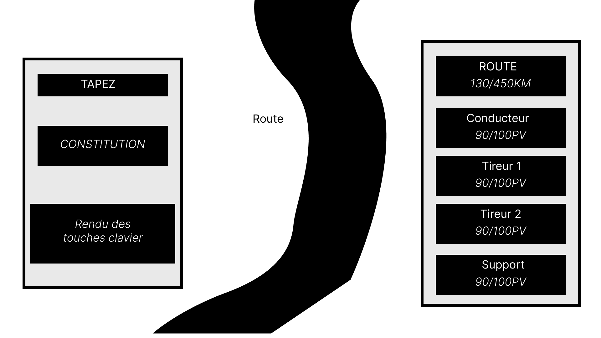

# Scénario

Cette section présente le scénario de l’interactivité du projet.

<!-- Pour chaque étape/scène : une image avec du texte descriptif et une explication de la transition -->

<!--
Éléments du scénarimage
Séquence visuelle
Chaque scène ou séquence du scénarimage doit être clairement illustrée, montrant les éléments visuels qui seront projetés ou affichés. Cette séquence visuelle peut inclure des captures d'écran, des croquis ou des rendus 3D, en fonction des besoins du projet.

Points d'interaction
Le scénarimage dans un cadre interactif inclut les moments où l'utilisateur interagit avec l'installation. Ces points d’interaction doivent être représentés graphiquement pour indiquer comment et quand l’utilisateur influencera la progression du récit ou des effets visuels et sonores.

Évolution du récit
Comme pour le scénario narratif, le scénarimage doit montrer la progression de l’histoire ou de l’expérience au fil des interactions. Il permet de visualiser comment l’installation évolue en fonction des actions de l'utilisateur, avec des embranchements possibles selon ses choix.

Retour visuel et sensoriel
Le scénarimage doit inclure des annotations ou des visuels montrant les réponses visuelles, sonores ou tactiles à chaque interaction. Cela peut inclure des changements d’éclairage, des transitions vidéo, ou des effets sonores qui réagissent aux actions de l’utilisateur.
-->

## Scène #1 : Conducteur

**Ce que l’interacteur voit :**
- Le clavier directement devant eux. 
- La projection avec l'interface et la route.

**Ce que l’interacteur entend :**
- Le son de la voiture.
- Le ding lorsque le mot écrit est correct.

### Tableau des automatisations
| Déclenchement | Effet visuel | Effet sonore | Effet interactif |
| -- | -- | -- | -- |
|     |     |     |     |

### Tableau des actions
| Verbe d’action | Condition / contexte | Effet visuel | Effet sonore | Effet interactif |
| -- | -- | -- | -- | -- |
| Écrire  |  Le mot correspondant  |  Feedback de clavier sur l'interface  |  Ding quand le mot est correct  |  La voiture continue à avancer  |